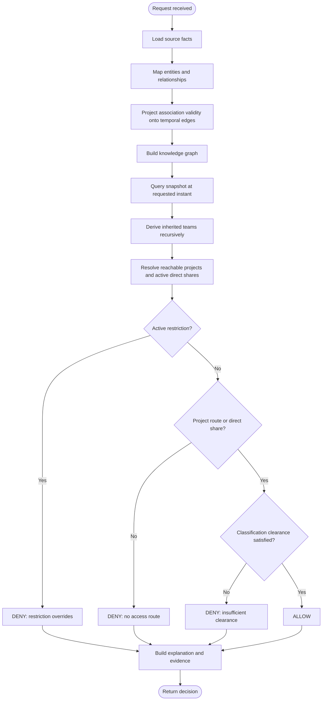

# Authorization activity

The activity applies deny-overrides: an active restriction stops evaluation before any allow route can grant access. Confidential clearance is required for both project access and direct-share access.
