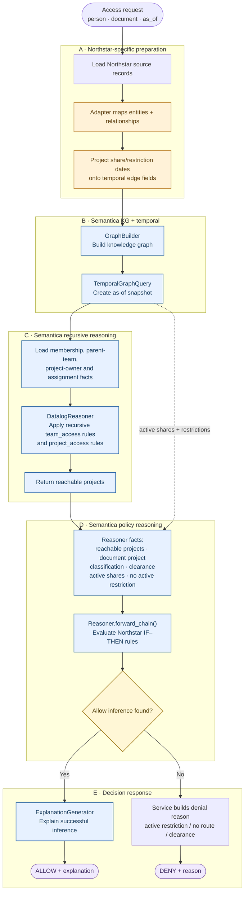

# Authorization decision — activity by Semantica stage

## Reading the decision

- **TemporalGraphQuery** removes expired or not-yet-effective share/restriction edges for the requested instant.
- **DatalogReasoner** derives inherited team membership and project reachability; this is the recursive part.
- **Reasoner** grants access only when a project route or direct share meets the classification rule and there is no active restriction.
- An active restriction prevents the service from adding the `NoActiveRestriction` fact, so no Allow rule can use that pair.
- **ExplanationGenerator** explains successful Allow inference. The current POC formats denial reasons in application code.
