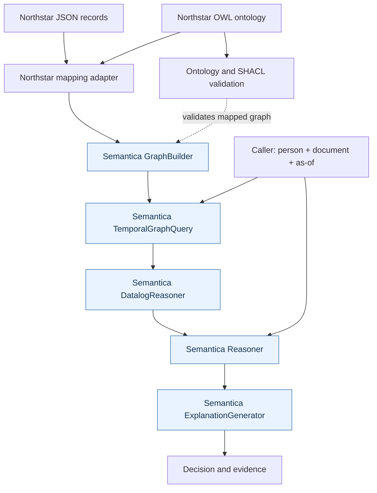

# High-level architecture

## Responsibilities

| Layer | Responsibility |
|---|---|
| Source JSON | People, teams, memberships, projects, assignments, documents, clearances, shares and restrictions |
| OWL ontology | Declares domain classes/properties; reified classes represent relationships that carry attributes |
| Mapping adapter | Translates Northstar source fields and projects association dates to temporal KG edge fields |
| GraphBuilder | Builds Semantica's entity/relationship knowledge graph |
| TemporalGraphQuery | Produces a graph valid at the requested instant |
| DatalogReasoner | Calculates recursive parent-team and project reachability |
| Reasoner | Applies allow rules to reachable projects, direct shares, classification, clearance and restriction facts |
| ExplanationGenerator | Explains a successful inference result |

## Important boundary

A date stored on an OWL association individual is not automatically an edge-level temporal interval. The adapter makes that transformation explicit. The ontology describes the domain; it does not, by itself, generate Northstar-specific ETL mappings or the edge structure required by temporal graph queries.

This is a POC architecture. Production use would additionally need authentication, policy versioning, audit persistence, graph update/retraction handling, concurrency tests, and security review.
