# System architecture — Semantica components in Northstar

This view separates **ontology design time** from the **authorization runtime** and highlights exactly where each Semantica component is used.

```mermaid
flowchart LR
    subgraph DESIGN["1 · DESIGN TIME — model the domain"]
        direction TB
        JSONS["Northstar source structure<br/>JSON fields + domain requirements"]
        LLMOG["Semantica · LLMOntologyGenerator<br/>Proposes classes + properties"]
        OWLG["Semantica · OWLGenerator<br/>Exports OWL / Turtle"]
        REVIEW["Human review<br/>Curated northstar.ttl"]
        JSONS --> LLMOG --> OWLG --> REVIEW
    end

    subgraph INGEST["2 · INGESTION — prepare graph input"]
        direction TB
        DATA[("Northstar JSON<br/>people · teams · projects<br/>documents · shares · restrictions")]
        ADAPTER["Northstar adapter<br/>Maps source records to entities + edges<br/>Projects share/restriction dates to<br/>valid_from / valid_until"]
        DATA --> ADAPTER
        REVIEW -. "domain model guides mapping" .-> ADAPTER
    end

    subgraph SEMANTICA["3 · SEMANTICA RUNTIME — build, query, reason"]
        direction TB
        GB["KG · GraphBuilder<br/>Builds the knowledge graph"]
        TGQ["KG · TemporalGraphQuery<br/>Point-in-time graph snapshot"]
        DR["Reasoning · DatalogReasoner<br/>Recursive team ancestry<br/>+ project reachability"]
        R["Reasoning · Reasoner<br/>Applies IF–THEN access rules"]
        EG["Reasoning · ExplanationGenerator<br/>Explains successful inference"]
        GB --> TGQ --> DR --> R --> EG
    end

    REQUEST["Access request<br/>person · document · as_of"] --> TGQ
    ADAPTER --> GB
    EG --> RESULT["Decision + explanation"]
    R -. "no Allow proof" .-> DENY["DENY + reason"]
    DENY --> RESULT

    classDef sem fill:#e7f1ff,stroke:#2864a5,color:#15385b,stroke-width:1.5px
    classDef custom fill:#fff2d8,stroke:#b7791f,color:#5b3b0b,stroke-width:1.5px
    classDef data fill:#edf7ed,stroke:#43834a,color:#214d27
    classDef output fill:#f1eafe,stroke:#7751a8,color:#38245b
    class LLMOG,OWLG,GB,TGQ,DR,R,EG sem
    class ADAPTER custom
    class DATA,JSONS data
    class RESULT,DENY output
```

## Component map

| Semantica component | What it does here | Project usage |
|---|---|---|
| `LLMOntologyGenerator` | Proposes ontology classes and properties from domain guidance and source structure | Optional design-time ontology proposal |
| `OWLGenerator` | Exports the proposed ontology as OWL/Turtle | Optional design-time export |
| `GraphBuilder` | Builds the entity/relationship knowledge graph | Runtime graph construction |
| `TemporalGraphQuery` | Filters time-bounded relationships for an `as_of` instant | Runtime snapshot for shares and restrictions |
| `DatalogReasoner` | Derives recursive facts to a fixpoint | Runtime team-parent closure and project reachability |
| `Reasoner` | Applies IF–THEN rules to facts | Runtime document allow inference |
| `ExplanationGenerator` | Produces a natural-language explanation for an inference | Runtime explanation for successful Allow inference |

## What is custom, and why?

**Northstar adapter (custom):** maps this domain's JSON collections into the graph shape consumed by `GraphBuilder`. It also projects validity dates from reified `DirectDocumentShare` and `DocumentRestriction` records onto temporal relationship fields. That is a source-model transformation, not a replacement reasoning engine.

**Authorization rules (domain policy):** the project defines which routes grant access, the Confidential clearance requirement, and the deny-overrides restriction behaviour. Semantica's `Reasoner` evaluates those rules; the policy itself is Northstar-specific.

## Important scope distinction

- Ontology generation is an **optional design-time workflow**. The curated `ontology/northstar.ttl` is reviewed and maintained separately.
- The current authorization runtime uses the graph and reasoning components. It does not call the ontology LLM on every access request.
- `ExplanationGenerator` is called for a successful inferred Allow. Denials currently use explicit application-level reason messages.
- This is a proof of concept, not a production authorization service.
