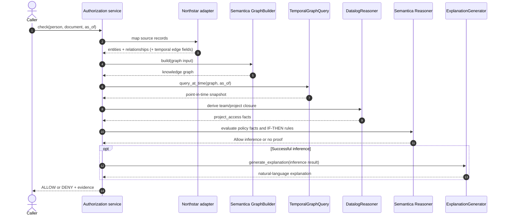

# Authorization request sequence

The default CLI uses the deterministic reference evaluator for a fast demonstration. The Python function `evaluate_with_semantica` exercises the Semantica-backed reasoning path.
