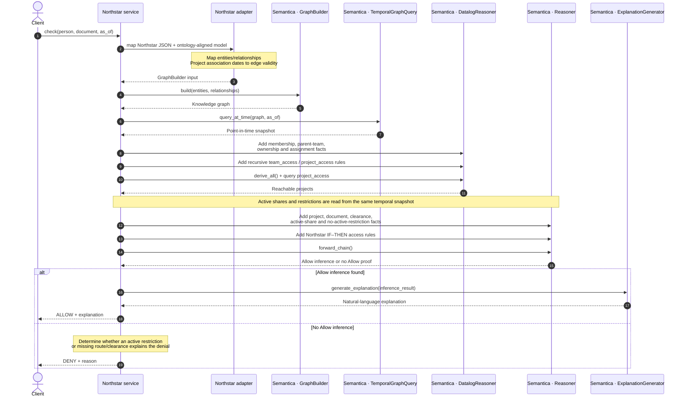

# Authorization request — sequence by component

The sequence below shows the **runtime path**. Ontology proposal generation is intentionally excluded: it is a separate, optional design-time activity.

## Where each component participates

1. **GraphBuilder** turns the adapter's mapped entities and relationships into the KG.
2. **TemporalGraphQuery** supplies the graph valid at the requested instant.
3. **DatalogReasoner** recursively derives inherited teams and project access.
4. **Reasoner** evaluates the document policy against those derived facts and the active temporal facts.
5. **ExplanationGenerator** explains a successful Allow inference. Denial messages are currently assembled by the service.

See the [high-level architecture](architecture.md) for the design-time ontology workflow and the custom/Semantica boundary.
